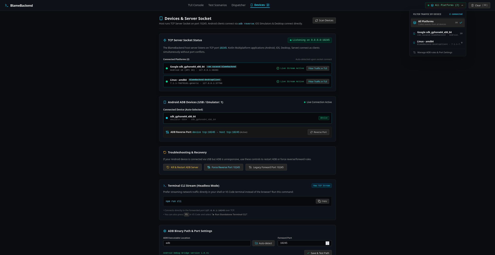
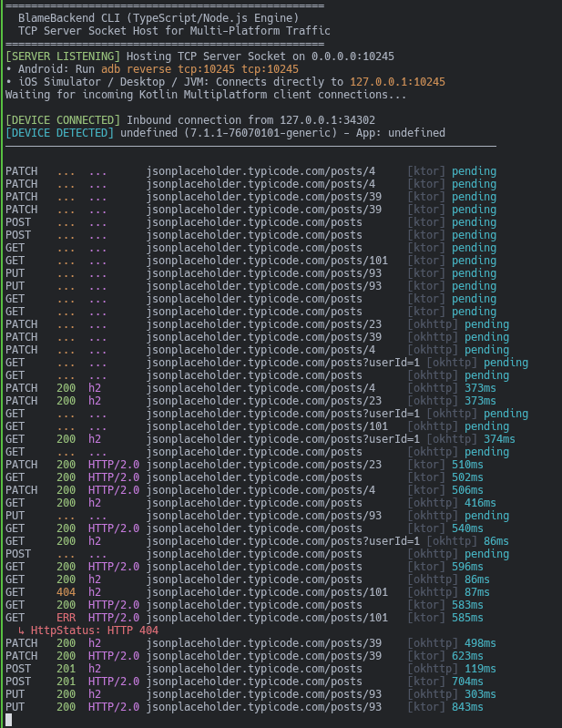

# BlameBackend [](https://jitpack.io/#cagdasc/BlameBackend)

> **Real-time Kotlin Multiplatform Network Inspector & Terminal TUI for Ktor and OkHttp.**  
> BlameBackend captures HTTP/HTTPS traffic directly from your Kotlin Multiplatform apps (Android, iOS, Compose Desktop, JVM, and Linux) over a local TCP socket, streaming requests, responses, headers, and timings straight into a modern terminal-style web console or headless shell CLI.

> **Note:** Vibe coded. No idea where it goes.

<video
  src="https://github.com/user-attachments/assets/7ae5331e-1eea-4cbf-94d4-2880ddb94b15"
  poster="assets/tui.png"
  controls>
</video>

---

## Notice: Client Library Status

> ⚠️ **The Kotlin Multiplatform client library is still actively under development.**  
> There is **published artifact in JitPack**. To use it in your multiplatform app, include the following dependency to your common sourceset.
>
> ```kotlin
> implementation("com.github.cagdasc.BlameBackend:network-inspector:<version>")
> ```

---

## Features

- **Zero Semantics Alteration**: Intercepts requests and responses non-destructively using OkHttp's `peekBody`.
- **Automatic Port Forwarding**: Automatically detects attached USB devices and emulators, forwarding `tcp:10245` on selection.
- **Interactive TUI Console**: Keyboard-driven UI (`j`/`k` navigation, `/` search, `c` clear, `Tab` panel switching).
- **Headless Terminal CLI**: Stream colored requests directly in your shell (`blamebackend --cli`).
- **Sensitive Data Redaction**: Automatic redaction of auth tokens, cookies, and secret headers.
---

## Documentation & Architecture

- 🤖 [**AGENTS.md**](AGENTS.md): Universal machine-readable specifications and boundaries for AI coding agents ([agents.md](https://agents.md/)).
- 📚 [**Full Tech Stack & System Architecture**](docs/TECH_STACK.md): Detailed breakdown of all 6 applications and modules, wire schemas, and network topologies.
- 📐 [**Developer Habits, DOs & DON'Ts**](docs/CODING_HABITS.md): Coding rules, non-destructive stream peeking, fail-soft patterns, and PR checklist.
- 🛠️ [**Developer Habits Skill**](skills/developer-habits/SKILL.md): Reusable AI agent & IDE skill encapsulating personal coding standards and architecture rules.

---

## Installation & Running

### Install from GitHub Releases (.tar.gz with npm)

Download or install the package tarball directly from GitHub Releases using npm:

```bash
# 1. Install globally from GitHub Release tarball:
npm install -g https://github.com/cagdasc/BlameBackend/releases/download/v0.0.1-alpha01/blamebackend-v0.0.1-alpha01.tgz

# (Or install the latest release directly via universal alias)
npm install -g https://github.com/cagdasc/BlameBackend/releases/latest/download/blamebackend.tgz

# 2. Run anywhere:
blamebackend        # Web Console
blamebackend --cli  # Terminal CLI
```

*(Optional: Checksums are provided in `checksums.txt` on the release page to verify tarball integrity with `sha256sum -c checksums.txt`)*

---

### Option 2: Run from Source

```bash
# Clone the repository
git clone https://github.com/cagdasc/BlameBackend.git
cd BlameBackend

# Install dependencies
npm install

# Start development server (http://localhost:3000)
npm run dev

# Or run terminal CLI
npm run cli
```
*(In VS Code, you can also press `Ctrl+Shift+B` / `Cmd+Shift+B` to launch the server, or press `F5` to debug).*

---

## Kotlin Multiplatform (KMP) Setup
The client library supports **Android, iOS, Compose Desktop, JVM, and Linux** using either Ktor Client or OkHttp.

### 1. Initialize NetworkInspector
Initialize the inspector at application startup to register device info and open the background transport socket (`127.0.0.1:10245`):

**Multiplatform / iOS / Linux (`commonMain` / Platform Entry):**
```kotlin
import com.cacaosd.networkinspector.transport.NetworkInspector
import com.cacaosd.networkinspector.transport.NetworkInspectorConfig
import com.cacaosd.networkinspector.protocol.HelloPayload

NetworkInspector.install(
    helloPayload = HelloPayload(
        deviceName = "iOS Simulator",      // or your platform device identifier
        osVersion = "iOS 17.5",
        appName = "com.example.kmpapp",
        appVersion = "1.0.0"
    ),
    configuration = NetworkInspectorConfig(
        port = 10245,                      // Defaults to 10245
        maxBodySizeBytes = 64 * 1024L      // Safe body buffer limit (64 KB)
    )
)
```

**Android (`androidMain` - `Application.onCreate`):**
```kotlin
import com.cacaosd.networkinspector.transport.NetworkInspector
import com.cacaosd.networkinspector.transport.install

// In your Application.onCreate:
NetworkInspector.install(this)
```

**Desktop / JVM (`jvmMain` - `main`):**
```kotlin
import com.cacaosd.networkinspector.transport.NetworkInspector
import com.cacaosd.networkinspector.transport.install

NetworkInspector.install(
    appName = "MyDesktopApp",
    appVersion = "1.0.0"
)
```

### 2. Ktor Client Integration (`commonMain` - Multiplatform)
For multiplatform HTTP requests across Android, iOS, Compose Desktop, and Linux, install the `NetworkInspectorPlugin`:

```kotlin
import io.ktor.client.HttpClient
import com.cacaosd.networkinspector.ktor.NetworkInspectorPlugin

val client = HttpClient {
    install(NetworkInspectorPlugin)
}
```

### 3. OkHttp Interceptor (`androidMain` & `jvmMain`)
For Android or JVM apps using OkHttp:

```kotlin
import okhttp3.OkHttpClient
import com.cacaosd.networkinspector.okhttp.NetworkInspectorInterceptor

val client = OkHttpClient.Builder()
    .addInterceptor(NetworkInspectorInterceptor())
    .build()
```

### 4. Running Sample Applications

**Android App:**
```bash
cd client
./gradlew :app:installDebug
```
*Tip: Open the **Devices** tab in BlameBackend—attached Android devices and emulators are auto-detected and port-forwarded with `adb reverse tcp:10245 tcp:10245`.*

**Compose Desktop App:**
```bash
cd client
./gradlew :composeApp:run
```
*Desktop and iOS simulator apps connect directly to `127.0.0.1:10245` without requiring ADB.*



### 5. Terminal CLI Preview

```bash
blamebackend --cli
# or: npm run cli
```



---

## License

```text
Copyright 2026 Cagdas

Licensed under the Apache License, Version 2.0 (the "License");
you may not use this file except in compliance with the License.
You may obtain a copy of the License at

    http://www.apache.org/licenses/LICENSE-2.0

Unless required by applicable law or agreed to in writing, software
distributed under the License is distributed on an "AS IS" BASIS,
WITHOUT WARRANTIES OR CONDITIONS OF ANY KIND, either express or implied.
See the License for the specific language governing permissions and
limitations under the License.
```
