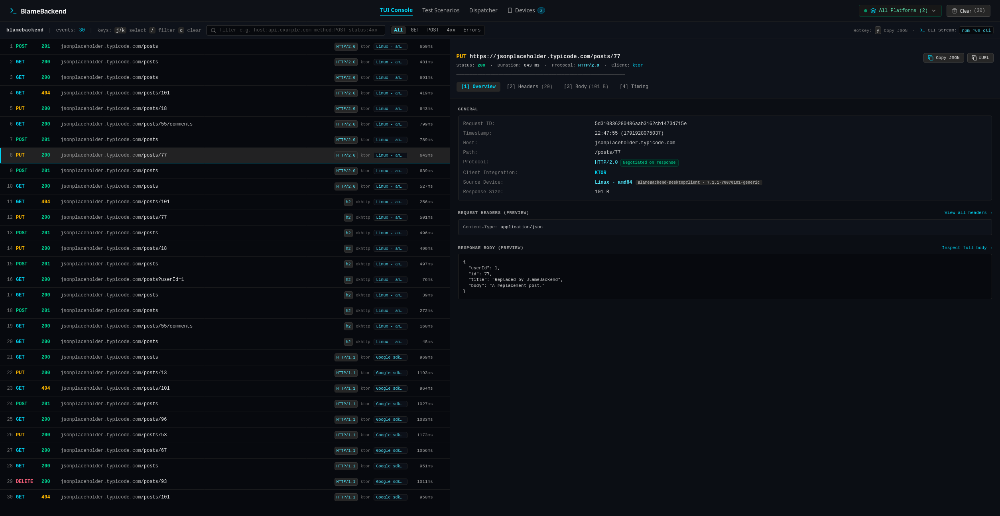

# BlameBackend

> **Real-time Kotlin Multiplatform Network Inspector & Terminal TUI for Ktor and OkHttp.**  
> BlameBackend captures HTTP/HTTPS traffic directly from your Kotlin Multiplatform apps (Android, iOS, Compose Desktop, JVM, and Linux) over a local TCP socket, streaming requests, responses, headers, and timings straight into a modern terminal-style web console, native desktop app, or headless shell CLI.

> **Note:** Vibe coded. No idea where it goes.



---

## Notice: Client Library Status

> ⚠️ **The Kotlin Multiplatform client library is still actively under development.**  
> There is **no published artifact (Maven Central / JitPack) yet**. To use it in your multiplatform app, include the `:network-inspector` module locally from `/client/network-inspector`:
>
> ```kotlin
> implementation(project(":network-inspector"))
> ```

---

## Features

- **Zero Semantics Alteration**: Intercepts requests and responses non-destructively using OkHttp's `peekBody`.
- **Automatic Port Forwarding**: Automatically detects attached USB devices and emulators, forwarding `tcp:10245` on selection.
- **Interactive TUI Console**: Keyboard-driven UI (`j`/`k` navigation, `/` search, `c` clear, `Tab` panel switching).
- **Headless Terminal CLI**: Stream colored requests directly in your shell (`blamebackend --cli`).
- **Sensitive Data Redaction**: Automatic redaction of auth tokens, cookies, and secret headers.
- **Binary & Image Inspection**: Safe hex preview for non-text payloads.

---

## Installation & Running

### Option 1: Run with `npx` (No Install Required)

```bash
# Launch the Web Console (opens on http://localhost:3000)
npx blamebackend

# Or stream traffic directly in your terminal
npx blamebackend --cli
```

---

### Option 2: Install from GitHub Releases

Download `blamebackend-v0.0.1-alpha01.tgz` and `checksums.txt` from the [Releases](https://github.com/cagdasc/Vibe-BlameBackend/releases) page:

```bash
# 1. (Optional) Verify checksum
sha256sum -c checksums.txt

# 2. Install globally from GitHub Release URL:
npm install -g https://github.com/cagdasc/Vibe-BlameBackend/releases/download/v0.0.1-alpha01/blamebackend-v0.0.1-alpha01.tgz

# (Or install the latest release directly via universal alias)
npm install -g https://github.com/cagdasc/Vibe-BlameBackend/releases/latest/download/blamebackend.tgz

# 3. Run anywhere:
blamebackend        # Web Console
blamebackend --cli  # Terminal CLI
```

---

### Option 3: Run from Source

```bash
# Clone the repository
git clone https://github.com/cagdasc/Vibe-BlameBackend.git
cd Vibe-BlameBackend

# Install dependencies
npm install

# Start development server (http://localhost:3000)
npm run dev

# Or run terminal CLI
npm run cli
```
*(In VS Code, you can also press `Ctrl+Shift+B` / `Cmd+Shift+B` to launch the server, or press `F5` to debug).*

---

## Kotlin Multiplatform (KMP) Setup
The client library supports **Android, iOS, Compose Desktop, JVM, and Linux** using either Ktor Client or OkHttp.

### 1. Ktor Client Integration (`commonMain` - Multiplatform)
For multiplatform code running on iOS, Android, Desktop, or Linux:

```kotlin
import io.ktor.client.HttpClient
import com.cacaosd.networkinspector.ktor.NetworkInspectorKtorPlugin

val client = HttpClient {
    install(NetworkInspectorKtorPlugin) {
        // Defaults to 127.0.0.1:10245 (or specify host machine IP for physical devices)
        host = "127.0.0.1"
        port = 10245
    }
}
```

### 2. OkHttp Interceptor (`androidMain` & `jvmMain`)
For Android or JVM apps using OkHttp:

```kotlin
import okhttp3.OkHttpClient
import com.cacaosd.networkinspector.NetworkInspector
import com.cacaosd.networkinspector.okhttp.NetworkInspectorInterceptor

// In your Android Application onCreate:
NetworkInspector.install(this)

// In your OkHttpClient builder:
val client = OkHttpClient.Builder()
    .addInterceptor(NetworkInspectorInterceptor())
    .build()
```

### 3. Running Sample Applications

**Android App:**
```bash
cd client
./gradlew :app:installDebug
```
*Tip: Open the **Devices** tab in BlameBackend—attached Android devices and emulators are auto-detected and port-forwarded with `adb reverse tcp:10245 tcp:10245`.*

**Compose Desktop App:**
```bash
cd client
./gradlew :composeApp:run
```
*Desktop and iOS simulator apps connect directly to `127.0.0.1:10245` without requiring ADB.*


### 4. Custom Request Dispatcher

Test endpoint edge cases or inject custom payloads directly into the inspector using the built-in Dispatcher:


### 4. Standalone Terminal CLI Preview

```bash
blamebackend --cli
# or: npm run cli
```


---

## License

```text
Copyright 2026 Cagdas

Licensed under the Apache License, Version 2.0 (the "License");
you may not use this file except in compliance with the License.
You may obtain a copy of the License at

    http://www.apache.org/licenses/LICENSE-2.0

Unless required by applicable law or agreed to in writing, software
distributed under the License is distributed on an "AS IS" BASIS,
WITHOUT WARRANTIES OR CONDITIONS OF ANY KIND, either express or implied.
See the License for the specific language governing permissions and
limitations under the License.
```
